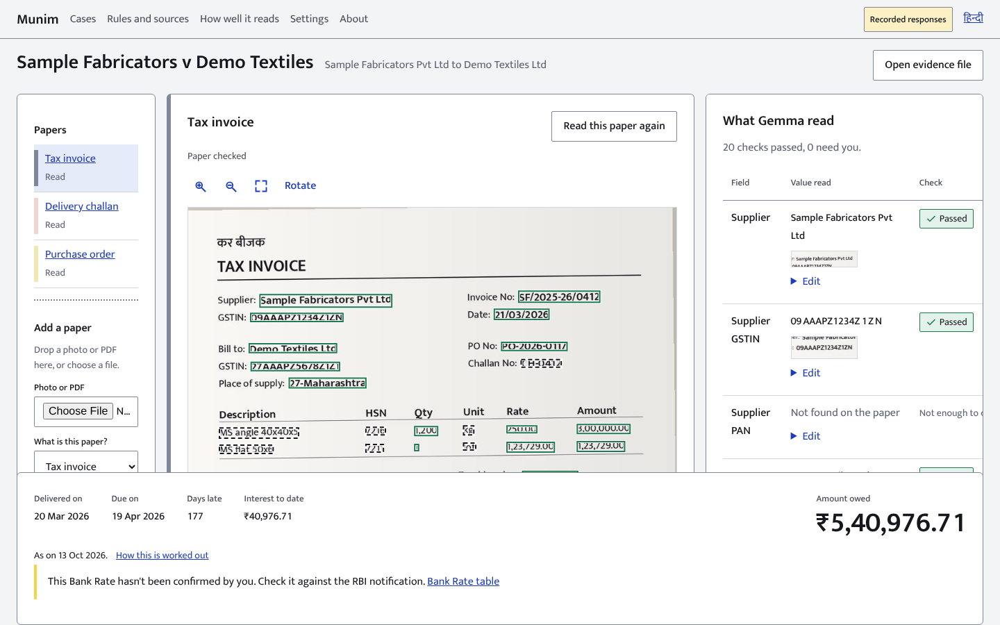

# Munim

Proof of dues for small suppliers in India.

Munim reads photos of a tax invoice, a delivery challan and a purchase order, checks them against each other, works out what the Micro, Small and Medium Enterprises Development Act says is owed, and prints an evidence file with a draft notice in English and Hindi. It runs on your own computer with an open-weight model (Gemma 4), so the papers stay with you.

> **Status: v0.1.0.** Built on 12 and 13 Oct 2026, starting before the Hacktoberfest Hack Day Pune kickoff, so it is not an event-day build (see `docs/PROGRESS.md`). Live-model evaluation recorded in `eval/reports/latest.json`.
> Munim reads and calculates. It does not give legal advice and does not file anything.



Screenshots in `docs/screens/` are generated by `make screens` on the recorded responses, not drawn by hand.

## What it does

1. **Reads.** Drop a photo or PDF. Gemma 4 writes down the fields it can see and where on the page each one is.
2. **Checks.** Code, not the model, decides what passes: GSTIN structure and checksum, GST arithmetic, dates, and agreement between the three papers.
3. **Repairs.** When a check fails, Munim crops that one box, asks the model to read it again, and shows the correction: the old value struck through in red, the new one written in blue, with the reason.
4. **Counts.** You confirm the dates and terms. Munim computes the due date and the compound interest under sections 15 and 16 of the Act, and shows every step.
5. **Prints.** An evidence file: summary, evidence table with a crop of each source box, the working, the original photos, and a draft notice.

## Install

Requirements: Python 3.12, [uv](https://docs.astral.sh/uv/), and (for live reading) [Ollama](https://ollama.com).

```
git clone https://github.com/Gaurav-205/Hacktober munim && cd munim
make install
ollama pull gemma4:e4b          # skip this to use recorded responses
make run                        # http://127.0.0.1:8765
```

No Ollama? `MUNIM_PROVIDER=replay make run` uses recorded responses on the bundled synthetic papers (the interface says so on screen). To use hosted Gemma 4 instead, set `GEMINI_API_KEY`, choose it in Settings and accept the consent line: your photos are then sent to Google's servers.

## Privacy

- Papers and what is read from them are stored in `./data` on your computer. **Delete case** removes the files and rows.
- With the default reader nothing leaves your computer. The app makes no requests to any other site.
- The hosted demo (`munim-demo.vercel.app`, from `api/index.py`) is different: it runs on Vercel's servers, reads only with recorded responses on the bundled synthetic papers, and anything you upload there is held on those servers in temporary storage. Use the demo with the synthetic papers only; run Munim on your own computer for real papers. To serve it under another domain, set `MUNIM_PUBLIC_HOST`.
- Aadhaar-like numbers are masked in stored text. The photo itself is not redacted; please do not photograph Aadhaar cards.
- Full threat model: `docs/SECURITY_PRIVACY.md`.

## How well does it read?

Live-model evaluation is recorded in `eval/reports/latest.json` using `gemma-4-26b-a4b-it` over 3 papers (58 fields):
- Required fields exact match: 17 of 17 (100.0%)
- Amounts exact match: 10 of 10 (100.0%)
- Identifiers exact match: 10 of 10 (100.0%)
- Box IoU >= 0.5: 53 of 57 (92.98%)
- Wrong and passed: 1 of 58 (1.72%; only receiver signature flag misread)
- Invalid JSON failures: 0

The evaluation harness is also tested on recorded replay responses for 30 synthetic papers (`eval/reports/replay.json`): there, 26 of 660 fields were deliberately misread and the checks caught 13. That measures the checks and the harness, not the model.

| Measure on the synthetic recordings | Result |
| --- | --- |
| Wrong value that no check caught ("wrong and passed") | 13 of 660 fields |
| Wrong values the checks flagged | 13 of 26 |
| Model misreads corrected by the re-read | 8 of 8 attempted |
| Injected GSTIN faults | 1 corrected by the look-alike map, 1 unchanged (the fault is printed on the paper) |

Synthetic results do not predict results on your papers. Real-paper testing, described without publishing the papers, is in `docs/EVAL_REAL.md`. Failure examples are on the Evaluation page.

## What it does not do

- It does not decide whether you qualify for the Act's protection. The law on whether registration must predate the supply is unsettled; Munim shows the cases and asks you to check with counsel.
- It does not know the Bank Rate on its own. The table ships with three entries (5.75% from 6 Jun 2025, 5.50% from 5 Dec 2025, 5.75% from 7 Oct 2026), all **not confirmed**; you confirm or edit them on the Rules page, and the evidence file says which rate was used.
- It does not cover Section 43B(h) of the Income-tax Act, e-filing, reminders or payments.
- Hindi text is machine-drafted and **awaiting review by a native reader**.
- No dark mode: the product is used in bright rooms and printed on paper.

## Design

The interface is built around the challan book: white, pink and yellow sheets by paper type, ballpoint corrections, a red pen for what failed, and a rubber stamp when you confirm. `DESIGN.md` is the contract, enforced by `scripts/design_lint.py` and `scripts/check_contrast.py`.

## Develop

```
make check      # lint, types, security, design lints, unit/property/integration tests
make e2e        # browser journeys and axe checks in English and Hindi
make screens    # screenshots at 360, 768 and 1440 px in both languages
make dossier-pdf CASE=<id>   # print an evidence file to A4 PDF (needs make run)
make eval       # evaluation harness
```
Start with `AGENTS.md`, `docs/ARCHITECTURE.md` and `docs/TESTING.md`. Contributions welcome: see `CONTRIBUTING.md`.

## Licence and credits

Apache-2.0 (`LICENSE`). Gemma 4 is an open-weight model family released under the Apache 2.0 licence, per its model card (`docs/AI_SPEC.md` section 1). Components, fonts and ideas used are listed in `THIRD_PARTY.md`. How AI was used to build and to run the project: `docs/AI_CONTRIBUTION.md`.
